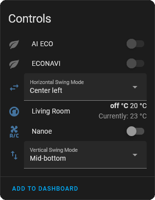
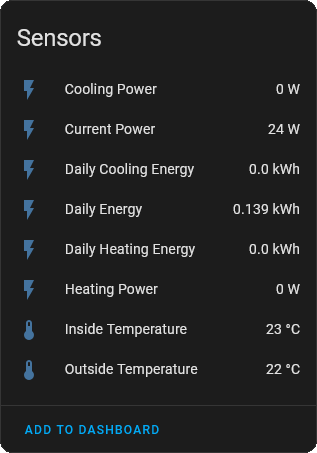
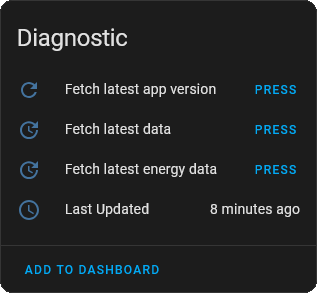
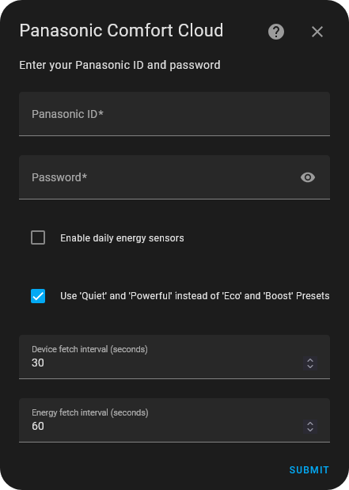
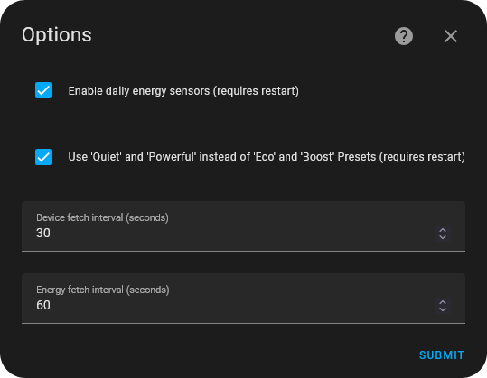

# Panasonic Comfort Cloud for Home Assistant

[![GitHub Release][releases-shield]][releases]
[![License][license-shield]](LICENSE)
[![Marketplace][marketplace-shield]][marketplace]
[](https://analytics.home-assistant.io/)

Control your Panasonic Comfort Cloud devices from [Home Assistant](https://home-assistant.io): air conditioners, Aquarea air-to-water heat pumps and standalone HWS hot water tanks. Everything the Comfort Cloud app shows becomes an entity you can put on a dashboard, use in automations and track in the Energy dashboard.

| Device family | What you get |
|---|---|
| **Air conditioners / heat pumps** | Climate control, swing, presets, Nanoe/ECONAVI/AI ECO and other feature switches, zone dampers, weekly timer, temperature and energy sensors |
| **Aquarea air-to-water heat pumps** | Climate entity per zone, hot water tank, quiet/powerful modes, force DHW/heater, holiday and weekly timer, favorite schedules, energy/cost, pressure, defrost and error sensors |
| **HWS hot water tanks** (e.g. HE-UM40CR) | Water heater with schedule/PV timer/holiday modes, boost mode, weekly schedule, tank temperature and energy/cost sensors |

<p>
    
    
    
</p>

## Before you install

> [!IMPORTANT]
> Panasonic requires two-factor authentication (2FA). Finish the whole 2FA setup in the Panasonic Comfort Cloud app before adding the integration.
>
> - **Authenticator app (TOTP), recommended.** During setup, the integration asks for the current 6-digit code from your authenticator app. You only enter it when you set up or sign in again, not on every poll.
> - **SMS.** Also works. The integration can't take an SMS code, but Panasonic doesn't ask for one when the integration signs in, so setup goes straight through without a verification step.
>
> We also recommend a separate Panasonic account for Home Assistant, so it doesn't conflict with the account you use in the app.

**Requirements**

- Home Assistant 2026.3.0 or newer
- A Panasonic Comfort Cloud account with your devices added in the app
- Internet access. The integration polls the Panasonic cloud (`cloud_polling`) and does not talk to devices on your local network.

## Installation

<!-- ha-marketplace:exclude-start -->
### Home Assistant Marketplace (recommended)

Home Assistant 2026.11 and newer include the Marketplace.

1. [](https://my.home-assistant.io/redirect/marketplace_repository/?owner=sockless-coding&repository=panasonic_cc&category=integration)
2. Press **Download**
3. Restart Home Assistant

### HACS (Home Assistant before 2026.11)

1. [Install HACS](https://hacs.xyz/docs/use/), if you haven't already
2. [](https://my.home-assistant.io/redirect/hacs_repository/?owner=sockless-coding&repository=panasonic_cc&category=integration)
3. Press **Download**
4. Restart Home Assistant

### Manual installation

1. Download the latest [release](https://github.com/sockless-coding/panasonic_cc/releases)
2. Copy the `custom_components/panasonic_cc` folder to `<config>/custom_components/panasonic_cc`
3. Restart Home Assistant
<!-- ha-marketplace:exclude-end -->

### Set up the integration

After installing and restarting:

[](https://my.home-assistant.io/redirect/config_flow_start/?domain=panasonic_cc)

Or go to **Settings → Devices & services → Add integration** and search for **Panasonic Comfort Cloud**. Then enter your Panasonic ID and password:



| Option | Description | Default |
|--------|-------------|---------|
| **Panasonic ID** | Your Panasonic Comfort Cloud account ID | — |
| **Password** | Your Panasonic Comfort Cloud password | — |
| **Enable daily energy sensors** | Create daily energy and current power sensors | Disabled |
| **Enable Nanoe switch for all devices** | Show the Nanoe switch even if the device doesn't report Nanoe support | Disabled |
| **Use Panasonic preset names** | Use "Quiet" and "Powerful" instead of "Eco" and "Boost" | Enabled |
| **Device fetch interval** | How often to poll device data (5–300 seconds) | 120s |
| **Energy fetch interval** | How often to poll energy data (10–600 seconds) | 300s |

### Options

After setup, change these from the integration's **Configure** button:



| Option | Description | Default |
|--------|-------------|---------|
| **Force outside sensor** | Show the outside temperature sensor even if no reading is available | Disabled |
| **Enable daily energy sensors** | Create daily energy and current power sensors | Disabled |
| **Enable Nanoe switch for all devices** | Show the Nanoe switch on all devices | Disabled |
| **Use Panasonic preset names** | Use "Quiet" and "Powerful" instead of "Eco" and "Boost" | Enabled |
| **Device fetch interval** | How often to poll device data (5–300 seconds) | 120s |
| **Energy fetch interval** | How often to poll energy data (10–600 seconds) | 300s |

> [!TIP]
> Some options only take effect after a Home Assistant restart. The integration tells you which ones.

---

## Entities

Entities only appear when your unit supports the feature. Entities marked *optional* need **Enable daily energy sensors**. Some entities are disabled by default and can be enabled from the entity settings.

### Air conditioners and heat pumps

**Climate**
- Heat, Cool, Auto, Dry and Fan modes with target temperature
- Fan modes limited to the speeds the unit supports. Ducted and commercial units may only have Low/Mid/High or a fixed speed.
- Preset modes (Quiet, Powerful, +8/15°C heat), where the unit supports them

**Select**
- **Horizontal swing** and **Vertical swing**

**Switches**
- **Fireplace**: circulates air to spread heat from a fireplace or other heat source (Heat mode only)
- **Nanoe**: Nanoe air purification
- **ECONAVI**: ECONAVI energy-saving mode
- **AI ECO**: AI ECO mode
- **iAUTO-X**: iAUTO-X intelligent auto mode
- **Inside Cleaning**: inside cleaning
- **nanoe Stand-alone**: runs nanoe air purification without heating or cooling. Turning it off turns the unit off.
- **Clothes Drying**: runs the clothes drying mode. Turning it off turns the unit off.
- **Zone Mode**: turns individual zones on/off
- **Weekly Timer**: turns the weekly schedule on/off. The schedule is in the `schedule` attribute.

**Number**
- **Zone Damper Position**: zone damper from 0 to 100%, in steps of 10

**Sensors**
- **Inside Temperature**, **Outside Temperature** and per-zone **Zone Temperature**
- **Daily Energy**, **Daily Heating Energy**, **Daily Cooling Energy** in kWh (optional)
- **Current / Heating / Cooling Extrapolated Power** in W, calculated from the energy readings (optional)

### Aquarea air-to-water heat pumps

**Climate and water heater**
- A climate entity for each zone
- **Hot water tank**: water heater with target temperature (40–65°C) and operation modes (Heat Pump, Off). Turning the tank or a zone on/off sends the same requests as the Comfort Cloud app.
- **DHW / EcoFlex**: standalone domestic hot water units use the same water heater entity. The setpoint range follows the unit's current DHW operation mode. Not yet tested against a real unit.

**Select**
- **Quiet Mode**: level1, level2, level3 or off
- **Powerful Time**: on-30m, on-60m, on-90m or off (heat pumps)
- **DHW Operation Mode**: heat_pump, heater_only or auto (DHW / EcoFlex units)

**Switches**
- **Force DHW**: forces domestic hot water mode
- **Force Heater**: forces heater mode
- **Holiday Timer**: turns the holiday timer on/off
- **Weekly Timer**: turns the weekly schedule on/off. Its attributes hold the schedule (`schedule`), the allowed setpoint ranges (`zone1_limits`, `zone2_limits`, `tank_limits`) and the names of the favorite schedules saved in the app (`favorites`).

**Sensors**
- **Outside Temperature** and **Tank Temperature**
- **Direction** and **Pump Status**
- **Water Pressure** in bar, where the unit reports it
- **Consumption Today**: heating, cooling, tank and total energy in kWh (optional)
- **Cost Today**: heating, cooling and tank cost (optional, disabled by default)
- **DHW / Zone / Defrost Cycles Today**: daily cycle counters (diagnostic)

**Binary sensors**
- **Error Status**: on when the unit is in an error state, with the raw fault status as an attribute
- **Defrost**: on while the unit is defrosting

**Button**
- **Request Defrost**: asks the unit to start defrosting

### HWS hot water tanks

**Water heater**
- Current tank temperature
- Operation modes Schedule, PV Timer and Holiday, as supported by the unit
- Away mode (Holiday)
- The weekly schedule as the `weekly_schedule` attribute

**Switches**
- **Boost Mode**: turns boost mode on/off
- **Holiday Timer**: switches between Holiday and Schedule mode

**Sensors**
- **Tank Temperature** and **Outside Temperature**
- **Tank Consumption Today** in kWh (optional)
- **Tank Cost Today** (optional, disabled by default)
- **Heat Pump Status**: on, off or unknown (diagnostic)
- **Boost Mode Status** (diagnostic)
- **Operation Mode**: Schedule, PV Timer or Holiday (diagnostic, disabled by default)
- **Schedule Mode Today / Set 1 Today / Set 2 Today / Inhibit Time Today**: today's entry of the weekly schedule, with the mode (timer or continuous) and its time windows. Set 2 also has its start/end temperatures as attributes. (diagnostic)

### All devices

**Diagnostic sensors**
- **Connection Status**: connected, degraded, disconnected or authentication_error
- **Data Mode**: LIVE, CACHED or OFFLINE
- **Last Updated**: when device data was last updated
- **Cached Data Age**: age of the cached data while the device is offline

**Buttons**
- **Fetch latest data**: refreshes device data from the cloud
- **Fetch latest energy data**: refreshes energy data from the cloud
- **Fetch latest app version**: refreshes the Comfort Cloud app version the integration sends

---

## Actions

### Set horizontal swing mode

`panasonic_cc.set_horizontal_swing_mode` sets the horizontal swing mode of a climate entity. It was kept for older automations; new ones can use the **Horizontal swing** select entity.

| Field | Description | Required |
|-------|-------------|----------|
| `entity_id` | The climate entity to control | Yes |
| `swing_mode` | `Auto`, `Left`, `LeftMid`, `Mid`, `RightMid` or `Right` | Yes |

```yaml
action: panasonic_cc.set_horizontal_swing_mode
data:
  entity_id: climate.living_room_ac
  swing_mode: Auto
```

### Set weekly timer day

`panasonic_cc.set_weekly_timer_day` replaces the patterns of one or more days of an air conditioner's weekly timer. Target the device's **Weekly Timer** switch. As in the Comfort Cloud app, saving turns the weekly timer on unless `enabled` is `false`.

| Field | Description | Required |
|-------|-------------|----------|
| `weekdays` | Days to replace: `monday` … `sunday` | Yes |
| `patterns` | Up to 6 patterns. Each has `start_time` (`HH:MM`) and optionally `power` (`on`/`off`), `mode` (`auto`, `dry`, `cool`, `heat`, `fan`, plus `nanoe_stand_alone` and `clothes_drying` on units that have them), `temperature` (°C) and `fan_speed` (`auto`, `low`, `low_mid`, `mid`, `high_mid`, `high`). An empty list clears the days. | Yes |
| `enabled` | Whether the weekly timer is on after saving (default `true`) | No |

The switch's `schedule` attribute uses the same format, so you can copy a day from it.

```yaml
action: panasonic_cc.set_weekly_timer_day
target:
  entity_id: switch.living_room_ac_weekly_timer
data:
  weekdays: [monday, tuesday, wednesday, thursday, friday]
  patterns:
    - start_time: "06:30"
      power: "on"
      mode: heat
      temperature: 21.5
      fan_speed: auto
    - start_time: "22:00"
      power: "off"
```

### Set Aquarea weekly timer day

`panasonic_cc.set_aquarea_weekly_timer_day` replaces the patterns of one or more days of an Aquarea heat pump's weekly timer. Target the Aquarea device's **Weekly Timer** switch. As in the Comfort Cloud app, saving turns the weekly timer on unless `enabled` is `false`.

| Field | Description | Required |
|-------|-------------|----------|
| `weekdays` | Days to replace: `monday` … `sunday` | Yes |
| `patterns` | Up to 6 patterns. Each has `start_time` (`HH:MM`) and optionally `mode` (`heat`, `cool`, `auto`), `zone1`/`zone2` (`on`/`off`) with `zone1_heat`, `zone1_cool`, `zone2_heat`, `zone2_cool` setpoints (whole °C), and `tank` (`on`/`off`) with `tank_temperature` (whole °C). Leave out zones or a tank the unit doesn't have. An empty list clears the days. | Yes |
| `enabled` | Whether the weekly timer is on after saving (default `true`) | No |

The switch's `schedule` attribute uses the same format, so you can copy a day from it. Keep setpoints within the ranges in the switch's `zone1_limits`, `zone2_limits` and `tank_limits` attributes. This action sends the same requests as the Comfort Cloud app but hasn't been tested against a real unit yet.

```yaml
action: panasonic_cc.set_aquarea_weekly_timer_day
target:
  entity_id: switch.aquarea_weekly_timer
data:
  weekdays: [monday, tuesday, wednesday, thursday, friday]
  patterns:
    - start_time: "06:00"
      mode: heat
      zone1: "on"
      zone1_heat: 22
      tank: "on"
      tank_temperature: 50
    - start_time: "22:00"
      mode: heat
      zone1: "on"
      zone1_heat: 18
```

### Apply Aquarea favorite schedule

`panasonic_cc.apply_aquarea_favorite_schedule` replaces an Aquarea unit's whole weekly timer with one of the favorite schedules saved in the Comfort Cloud app (app 5.x). Target the Aquarea device's **Weekly Timer** switch. The saved names are in its `favorites` attribute. As in the app, saving turns the weekly timer on unless `enabled` is `false`.

| Field | Description | Required |
|-------|-------------|----------|
| `name` | Name of the favorite schedule | Yes |
| `enabled` | Whether the weekly timer is on after saving (default `true`) | No |

```yaml
action: panasonic_cc.apply_aquarea_favorite_schedule
target:
  entity_id: switch.aquarea_weekly_timer
data:
  name: Winter
```

### Set hot water weekly schedule

`panasonic_cc.set_hws_weekly_schedule` replaces the weekly schedule of a standalone HWS hot water tank. Target the tank's water heater entity. It takes `weekly_schedule`, a list of days in the same format as the water heater's `weekly_schedule` attribute. Every day needs a `weekday` and a `mode`. The easiest way is to copy the attribute, edit it, and send it back.

---

## Troubleshooting

### Authentication
- **Verification code step**: if your account uses an authenticator app, setup and reconfigure show an extra "Verification code" step after your Panasonic ID and password. Enter the current code from the app. Codes change every 30 seconds, so if one is rejected, wait for the next one.
- **Authentication keeps failing**: reset MFA by logging out of the Comfort Cloud app and back in, then try again.
- **Session expired**: Home Assistant notifies you when authentication expires. Use **Reconfigure** on the integration to sign in again.

### Device data
- **Cached data**: while a device is offline, the integration shows its cached data. The **Data Mode** diagnostic sensor shows whether data is LIVE, CACHED or OFFLINE.
- **Stale readings**: press **Fetch latest data** to refresh straight away.
- **No outside temperature**: not every device reports it. Turn on **Force outside sensor** if you want the entity to always exist.

### Energy sensors
- **Energy sensors missing or not updating**: make sure **Enable daily energy sensors** is on in the options. Energy values reset every day.
- **Current power looks wrong**: current power is extrapolated from the daily energy reading, so it isn't an instantaneous measurement.

### Reporting a problem
Open an [issue](https://github.com/sockless-coding/panasonic_cc/issues) and attach the integration's diagnostics: **Settings → Devices & services → Panasonic Comfort Cloud → ⋮ → Download diagnostics**.

---

## Support and development

- **Issues and feature requests:** [GitHub Issues](https://github.com/sockless-coding/panasonic_cc/issues)
- **Contributing:** see [CONTRIBUTING.md](CONTRIBUTING.md)
- **Cloud library:** [`aio-panasonic-comfort-cloud`](https://github.com/sockless-coding/aio-panasonic-comfort-cloud)
- **Say thanks:** ☕ [Buy Me a Coffee](https://www.buymeacoffee.com/sockless)

This project is not affiliated with or endorsed by Panasonic.

[license-shield]: https://img.shields.io/github/license/sockless-coding/panasonic_cc.svg?style=for-the-badge
[releases-shield]: https://img.shields.io/github/release/sockless-coding/panasonic_cc.svg?style=for-the-badge
[releases]: https://github.com/sockless-coding/panasonic_cc/releases
[marketplace-shield]: https://img.shields.io/badge/Marketplace-Default-41BDF5.svg?style=for-the-badge&logo=home-assistant
[marketplace]: https://my.home-assistant.io/redirect/marketplace_repository/?owner=sockless-coding&repository=panasonic_cc&category=integration
